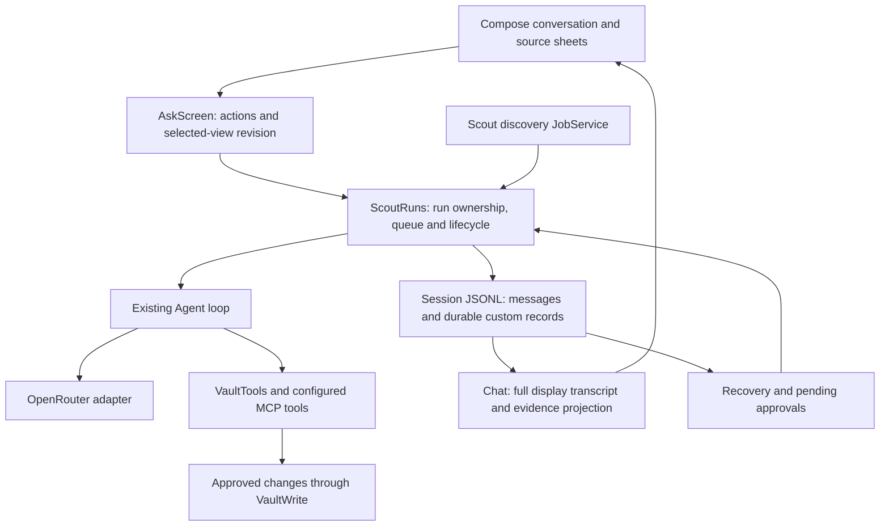

# Scout: a calm research workspace with durable execution

Date: 2026-11-16. Status: proposed design for review, not approved for implementation.

Companions: [reference investigation](../../research/2026-11-16-scout-reference-study.md) and [ChatGPT mobile UI and visual craft study](../../research/2026-11-16-chatgpt-mobile-ui-study.md). They record repository snapshots, source anchors, live observations, measured typography, screenshots and evidence limits.

## 1. Product decision

Keep Scout inside Sparkbox's existing native Android application. Keep Java core logic, Kotlin/Compose presentation, Markdown knowledge ownership, encrypted provider keys and direct provider/MCP connections. Improve the current harness rather than replacing it.

Use DeepSeek's interaction hierarchy: a quiet conversation canvas, one capable composer, compact activity and nearby source exploration. Add ChatGPT mobile's progressive controls, expanded editor and restrained typographic hierarchy. Use Papers with Code's execution principles: normalized events, explicit outcomes, durable state, evidence-backed answers and bounded research. Adapt these to one phone; do not import its distributed server architecture.

Scout must support three equally important jobs:

1. Investigate a question across the vault and optional external sources, then keep useful findings.
2. Discover worthwhile sources from explicitly selected interests, manually or on an optional schedule.
3. Connect and improve existing knowledge through reviewable, individually approved note changes.

All three current frustrations belong in the first research-workspace release: understanding progress, improving evidence/usefulness, and reducing context/steering/save friction. Scheduled discovery is a separate dependent delivery slice, not an abandoned aspiration.

### Confirmed constraints

- Phone-only. No server, hosted agent, account requirement or remote vault mirror.
- Android may delay scheduled work. Show that honestly.
- Scout may research without repeated approvals within the selected source/tool policy.
- Every note change requires its full preview and individual approval. No automatic vault editing.
- Both manual discovery and optional schedules are required.
- DeepSeek is the primary UI reference; Papers with Code is the primary backend and response-style reference.
- The phone composer shows text, + and Send/Stop by default. Research/source-scope chips appear only when active, as confirmed during the ChatGPT mobile investigation.
- Preserve existing `Knowledge/` and legacy `Sources/` access boundaries. Do not infer permission to read Daily, Weekly, Pacts or the whole vault.

### Success means

A person can see the current step, inspect what supports an answer, change direction without losing a message, and keep a useful finding without copying between screens. An interrupted run returns with truthful state. A failed or declined operation never appears successful. Discovery produces a small, relevant set of choices rather than an infinite feed.

## 2. Approaches considered

| Approach | Gain | Cost / limitation | Decision |
| --- | --- | --- | --- |
| Native Scout, strengthened in place | Reuses harness, vault safety, tools, Compose, usage and local ownership | Requires careful state and evidence changes | Recommended |
| DeepSeek React client embedded in WebView | Faster visual resemblance and existing rich browser rendering | Duplicate storage/state, JavaScript bridge, accessibility and key-handling complexity; provider-specific APIs | Reject as implementation foundation; borrow interaction patterns |
| Papers with Code style server agent | Durable hosted execution and schedules independent of phone | Hosting, authentication, remote vault context, operations and privacy changes | Reject under confirmed phone-only requirement |

No agent framework, vector database, Room, WorkManager, WebView or generic workflow engine is necessary for this design. Reconsider a dependency only against a demonstrated unmet requirement. Existing `Ask.search` already combines keyword and semantic retrieval; do not replace it with a new FTS pipeline because a reference assistant recommends one for a greenfield application.

## 3. Interface hierarchy

### A. Start screen

Header: chat drawer, Scout title, new chat. Under it, two quiet entry choices: Ask and Discover. Organizing knowledge starts from a note or an ordinary request; it does not need another permanent tab or agent persona.

The empty state says what Scout can do in two sentences. Offer at most three relevant starters, derived from available topics and explicit interests. Choosing a starter fills the composer; it does not spend tokens before the person sends it. If no vault/key is configured, show the missing setup action directly.

Schedules live inside Discover's overflow or settings sheet, not across the main conversation toolbar. The chat drawer groups Today, Previous 7 days and Older and surfaces Working, Waiting for approval, Interrupted and Failed states. Add search, Rename, Export and Delete through the existing drawer pattern. Delete retains its existing explicit confirmation.

### B. One composer, three layers

The composer is a rounded surface, combining DeepSeek's hierarchy with ChatGPT mobile's progressive disclosure:

1. Context chips above the text: selected notes, quoted passages and pending source references. Each chip has a remove action; tapping opens a preview.
2. Multiline text, growing to at most six lines or about 30% of the available conversation height before internal scrolling. Drafts remain editable offline. An Expand action opens a full-height editor using the same draft, attachments and caret state. Back/Collapse returns to chat without discarding anything.
3. A minimal lower action rail: + on the left and Send/Stop on the right. Research and source-scope controls are not permanent toolbar buttons. Voice, model/reasoning and tool configuration live in the + menu or its secondary section.

The + menu offers Add notes, Add quote/capture, Research and Sources first, with short explanatory subtitles where needed. Add file/voice only where the existing capability is available. Keep provider tool names and long plugin lists out of this menu. Selecting Research adds a removable active chip; choosing Vault + web adds a scope chip. Default Vault needs no chip, but the Sources menu always shows the selected scope. Removing an active chip changes future-turn configuration; it does not silently change a running request. `/research` updates the same visible state.

Source scope is `Vault` or `Vault + web`. Default to Vault for a new chat; retain an explicit choice per chat. Only show functional web choices when configured external tools satisfy search/read capabilities. Otherwise offer Connect tools. Research changes depth and limits; it is not a source-scope substitute. Prefer compact note/context rows over large square tiles for text. Loading, attached, unavailable and Remove states are explicit; a missing attachment cannot silently turn a scoped request into an unscoped one.

While work runs, keep Stop visible regardless of draft text or connectivity. When a direction is typed, show a compact Send direction action alongside Stop rather than replacing it. Send direction queues steering; the UI immediately shows the queued message with “After the current step,” plus Edit and Remove until consumed. If the person wants a later task rather than a direction, offer “After this answer” in the queue menu. The existing `Agent.followUp` capability can supply this without another execution framework.

Draft text, attached context, Research, source scope and unsent queue are owned by a session ID. New-chat drafts use a distinct local key. Never move a draft or note attachment into another conversation accidentally.

### C. Conversation and activity

Assistant prose flows on the screen background. User messages retain a restrained bubble. Approval cards, source previews and failures have surfaces because they require a distinct action; ordinary answers do not need a card border.

Place one activity summary before an answer: for example, “Read 4 notes · opened 3 pages · 1 page unavailable.” Count only completed reads, and distinguish found results from opened pages. Expand to a chronological timeline with current operation, successful operations, skipped/declined calls, failures, retry countdown and compaction notices. Default-collapse finished activity; preserve the user's expansion choice with stable IDs.

Use semantic labels such as “Searching your notes,” “Reading Context Windows,” and “Checking a source.” Raw tool names, arguments and provider errors belong in a Details section. Progress describes observed execution, not fabricated reasoning or an invented percentage. Do not imply that elapsed hidden reasoning is visible evidence.

For research, optionally display a compact question outline generated as part of the ordinary model response. It is orientation, not a second planner model or a guaranteed checklist. Change the outline when steering changes the task; avoid costly separate planning calls.

### D. Answers and sources

Each answer has a compact source strip: `3 notes · 2 web sources`. Tapping a numbered citation opens its source immediately. Tapping the strip opens all sources, filtered by Notes, Web and Captures. Distinguish “found,” “excerpt read,” “page read” and “unavailable.” A search snippet must not look like a fully read source.

Source detail includes title, origin, available publication/retrieval date, relevant excerpt, note path or host, and the claim's linked passage when available. Actions: Open note/page, Ask about this, Attach to next message, and Save source for web evidence. Opening an external page uses an allowed HTTP(S) target. Do not load arbitrary remote images simply to decorate source cards.

On a phone, use a full-height native source sheet with its own scroll and clear Back behavior. A single citation first opens a shorter preview with its supporting excerpt, coverage and Open/All sources actions. Keep previews short enough to dismiss easily; long evidence belongs in the full sheet. On larger windows, a side pane is optional after the phone experience works. Closing source detail restores the answer anchor and focus to its invoking reference. Separate cited evidence from other retrieved results. Source previews use claim-relevant text rather than website navigation boilerplate; provider-aware deduplication prevents tracking/account-selector URL variants from inflating the apparent evidence count.

Answer actions: Copy, Keep, and More. More can hold Retry answer, Make cards and Export. Retrying produces a new attempt linked to the original, not an unexplained overwrite. Branch trees, voice playback and elaborate artifacts can wait.

### E. Reading and accessibility

- Use stable session/message/block IDs in lazy-list keys, not item indexes.
- Follow live content only while the person is at the bottom. Scroll-up disables following until Jump to latest is tapped.
- Preserve the anchor when activity expands, source sheets open, keyboard changes height, or an answer becomes final.
- Reuse `SparkTheme`; one accent for actions, muted activity, error color only for failures.
- Body text around 16 sp with system font scaling; labels remain legible. Test 130% and 200%, narrow windows and keyboard overlap.
- Interactive targets at least 48 dp; correct roles and accessible names. State must never depend on color alone.
- Announce meaningful lifecycle changes once; do not announce every streamed token through TalkBack.
- Tables scroll horizontally if needed; paragraphs, lists, code and links remain selectable/readable. The current `Md` flattens tables and cannot add per-code-block controls inside one TextView; the scoped block presentation below addresses this observed gap while retaining inline parsing and link policy.

### F. Visual system: premium through consistent craft

Typography is a scoped Scout reading scale, not an app-wide enlargement. Current `SparkTheme.kt:37` uses bodyLarge 14/20 sp; `AskView.kt:154` separately uses a 15 sp TextView with a line-spacing multiplier. Replace that divergence with one centrally defined Scout style set used by both Compose and any retained TextViews. Do not pass explicit Scout sizes through `Ui.type`, which compresses them again. Preserve other screens' existing scale unless separately reviewed.

Use Android's native system sans family for prose/UI and native monospace for code. The measured ChatGPT web stack is platform-oriented; it does not establish a proprietary font to copy. Font scale remains a user preference, not a layout problem solved by shrinking text.

| Token | Size / line height | Weight | Use |
| --- | --- | --- | --- |
| `answerBody` | 16 sp / 26 sp | 400 | Final and streaming prose, lists |
| `answerHeading` | 18 sp / 28 sp | 600 | Main answer heading |
| `sectionHeading` | 16 sp / 24 sp | 600 | Evidence/findings subsections |
| `composerText` | 16 sp / 24 sp | 400 | Compact and expanded input |
| `sourceTitle` | 15 sp / 22 sp | 500 | Source previews and note context |
| `metadata` | 13 sp / 18 sp | 400 | Origin, coverage, time and activity |
| `tableText` | 14 sp / 22 sp | 400; header 600 | Structured comparison cells |
| `codeText` | 13 sp / 20 sp | 400 | Fenced code; native monospace |
| `inlineCode` | 15 sp within body line height | 500 | Short code identifiers |

These are proposed native tokens, translated from measured ChatGPT values where useful. They are not CSS px copied directly into Android. Strong emphasis uses semibold consistently; avoid bolding entire paragraphs. Prose uses normal letter spacing. No decorative all-caps labels, artificially condensed fonts or negative tracking are needed.

Spacing follows the existing 4 dp grid: 16 dp screen gutters; 12–16 dp paragraph separation; 24 dp before a new section; 8 dp between a heading and its content; 8 dp between related controls; 24 dp between conversation turns. The answer has no additional card inset inside those gutters. At larger widths, cap the reading column around 680 dp and center it. Long URLs, paths and identifiers must never force page-wide horizontal scrolling.

Preserve the approved Sparkbox colors from `Ui`: dark background `#0F141B`, surface `#171C23`, raised `#1E242D`, ink `#F1F5F9`, secondary `#94A3B8`, emerald `#10B981`; use the existing corresponding light-theme values. ChatGPT's sampled black/neutral palette is reference evidence, not a replacement brand. Reserve emerald for action, selection and source affordances; use ordinary ink for reading. No decorative gradients, glass surfaces or glowing progress elements.

Use a small shape vocabulary: composer 24 dp radius; source/approval panels 16 dp; context rows 12 dp; icon action circles. Borders are at most 1 dp and primarily distinguish actionable panels; do not outline every content block. Use standard consistent icons with 20–22 dp glyphs in at least 48 dp touch areas. The reference's measured 36 px boxes are not adopted as native touch targets.

Rendering contract: paragraphs/headings keep the same reading scale during streaming and finalization. Stable blocks can be cached by message/block/revision; only the unfinished block needs reparsing. Incomplete code fences remain a readable provisional block until closed. Finalization must not shrink the body or jump the scroll position.

Retain `Md`'s inline rules and permitted-link behavior, but give Scout a small block projection for prose/headings, tables and fenced code. A table keeps real header/cell relationships, readable padding and local overflow. Fenced code gets a language label, Copy and optional Wrap; copying preserves exact source whitespace rather than display soft wraps. Native code blocks do not execute content. Do not import a whole browser rendering stack for these controls. Mermaid execution, arbitrary HTML and remote embeds remain deferred; provide a clear textual/open-in-Obsidian fallback rather than silently dropping them.

Premium-quality checks before accepting implementation: no mixed body sizes between draft/final/preview; aligned baselines; legible muted labels; no clipped source titles or buttons at 320 dp; stable scroll/focus when sheets open; dark/light contrast checked; keyboard and system bars respected; 100%, 130% and 200% font scaling exercised. Test the real Android keyboard and TalkBack; browser-width screenshots do not establish those behaviors. Use short native transitions only where they preserve orientation, and honor reduced-motion preferences; do not add animation solely as decoration.

### Text layout reference

```text
Chats                 Scout                  New

                         User's question

Read 4 notes · opened 3 pages · 1 unavailable  >

Direct answer in ordinary prose. [1]
Evidence and caveat near the relevant claim. [2]

3 notes · 2 web sources                 Copy Keep

Direction queued: Focus on battery use       Edit

[Context: Agent Architecture ×]
[Research ×] [Vault + web ×]       (only if active)
Ask a follow-up…
+                                      Send Stop
```

The idle default has no mode chips and only one Send action. Stop appears only during active execution; Send direction may coexist when a draft is present. The + opens secondary actions. This is a structural wireframe, not a final visual mockup.

## 4. Response behavior inspired by live Papers with Code

Use answer contracts, not one rigid template for every message.

| Request | Default response shape |
| --- | --- |
| Simple factual question | Direct answer, supporting citation when evidence is needed, brief caveat if relevant |
| Explanation | Distinction/mechanism first; selected evidence; practical meaning |
| Comparison | Criteria and real tradeoffs; a table only when it improves comparison; note unmatched evaluation conditions |
| Research | Direct synthesis; named evidence; disagreement/gaps; implications; optional next question |
| Discovery | A finite set of candidates with relevance reasons, novelty and source status |
| Note organization | Explain intended change; present exact note preview; report only verified writes |

Borrow Papers with Code's nearby paper links, explicit benchmark limits and separation of findings from inference. In live testing, the assistant's practical follow-up explicitly said its Android/SQLite recommendation was engineering extrapolation, not a tested paper result. Preserve that distinction in Scout. A third query exposed a limitation: the assistant acknowledged citing a paper whose full text it had not retrieved. An expanded read operation also displayed success with an empty visible result. Scout must distinguish successful tool execution from useful evidence acquisition and show source coverage before being challenged.

Default ordinary answers should usually fit within roughly 400 words, often much less. This is a writing target, not a truncation limit. Research can be longer when asked; offer a kept Markdown result for durable long work. Never sacrifice necessary uncertainty or cut mid-thought to satisfy a word target.

Citations establish provenance, not truth. Do not label an entire answer “verified” because a URL was seen. Say “Source available,” “Based on an excerpt,” or “I could not substantiate this claim.” A single cited Topic may aggregate many independent sources; the current “Single source: 1 note” banner should become the accurate “Based on one note” unless source provenance establishes independence.

Suggested prompt policy: answer from relevant evidence; distinguish vault observations, external findings and inference; source empirical claims nearby; reuse evidence already read; do not search merely to appear busy; prefer a few well-supported findings over many weak ones; report relevant missing evidence. Captured Why/Ideas are owner instructions only when their origin is known; copied article text remains data.

## 5. Architecture and boundaries



No local HTTP server is necessary. UI observation uses the existing watcher pattern with immutable snapshots. A minimal pure-Java projector and typed records make this testable without Android. Do not create interfaces for every class; add a seam only where a fake clock, provider, persistence sink or vault is actually needed.

### Existing responsibilities to keep

| Unit | Responsibility | Required change |
| --- | --- | --- |
| `Agent` | Model/tool loop, queues, retries, cancellation | Preserve contracts; add explicit suspension and budget outcomes; fail closed on durability loss before effects |
| `Scout` | Prompt, tool loadout, model and policy binding | Persist configuration; source scope; capability-aware tool selection; evidence registration |
| `ScoutRuns` | Start, observe, cancel and recover local runs | Durable acceptance, run generation checks, queue acknowledgements and approval suspension |
| `Session` | Append-only record and model-context derivation | Separate display history, configuration, durable custom records and load/replay rules |
| `Chat` | Visible projection | Stable IDs, tool outcomes, source references and all retained history |
| `VaultTools` / `VaultWrite` | Validated changes and verified storage | Full proposed-change records; exact approval binding; preserve owner-managed sections |
| `OpenRouter` / `Mcp` | Network and protocol adapters | Bounded framing, terminal checks, cancellation, typed failures and capability metadata |
| `AskScreen` / `AskView` | UI actions and rendering | DeepSeek-inspired hierarchy, source sheets, durable drafts and scroll ownership |
| `ScoutUsage` / `SessionUsage` | Context and cost | Reuse ledger; request capability cache and policy estimate consistent with display |

Potential new files are limited to focused concerns: `ScoutState.java` for durable run/custom-record reduction; `ScoutEvidence.java` for source references; `ScoutDiscovery.java` plus `ScoutJob.java` for discovery and scheduling; and one Compose source/preview file if `AskView` becomes unwieldy. These are proposed boundaries, not a demand to split every concept into a new file.

## 6. Durable state and event contract

Retain session JSONL. Use existing custom entries for new state; do not invent a second authoritative transcript. Structural events are durable before the UI reports success. Streaming display snapshots are coalesced and explicitly provisional.

Minimal run configuration: `runId`, `generation`, session ID, goal, Research flag, source scope, model, thinking level, tool-policy revision, prompt revision and budget. Persist before starting model or MCP work. Retry/resume reads this configuration instead of silently selecting non-research mode.

Suggested event envelope:

```json
{
  "version": 1,
  "sessionId": "session-uuid",
  "runId": "run-uuid",
  "generation": 2,
  "sequence": 17,
  "kind": "tool_finished",
  "toolCallId": "call_3",
  "payload": {
    "name": "read",
    "outcome": "success",
    "path": "Knowledge/Topics/Agent Architecture.md",
    "elapsedMs": 43,
    "sourceIds": ["source-uuid"]
  }
}
```

This is an application record, not a new provider protocol. Reuse existing tool-call IDs. Persist lifecycle, tool start/result, approval proposal/decision/write receipt, accepted/consumed queue messages, source registry entries and terminal state. Full tool-result text already in the transcript is referenced, not duplicated in every event. Persist coalesced partial-text deltas at a bounded interval such as 500 ms and on suspension/terminal transitions, not per token or as a repeated copy of the entire answer. Deltas carry message ID, request-attempt ID and character offset; the final message supersedes their display projection. Set explicit serialized-byte and record-count limits per run, initially 8 MiB and 4096 structural/batched records; reaching a limit interrupts further retrieval with a recoverable reason rather than silently dropping evidence. These are proposed bounds to exercise in fixture tests.

Reserve journal capacity for final write receipts, failure and terminal records before admitting additional retrieval; budget exhaustion must not prevent recording why the run stopped. Large proposal content is checked before acceptance and cannot consume this reserve. On replay, `(runId, generation, sequence)` orders/deduplicates events. Reject old-generation mutations. Session append serializes sequence assignment. UI jobs carry selected session plus view revision; late callbacks update their owning session but never overwrite another chat's view.

### Lifecycle

`accepted`, `starting`, `waiting_model`, `waiting_tools`, `waiting_approval`, `cancelling`, then `completed`, `completed_partial`, `failed`, `cancelled` or `interrupted`.

`waiting_approval` is a durable suspended state with no network call or blocked worker retained. On launch, a nonterminal run with no live owner becomes Interrupted, except a durable pending approval remains reviewable. It is never displayed as still working forever.

A terminal record has one outcome and a recoverable reason code. Partial completion means useful output exists but coverage/time/source availability is incomplete; it is not ordinary success. Do not display failure as success simply because a final summary was generated.

### Storage guarantees and migration

- Additive custom records can remain compatible with version-1 JSONL. If the schema's required interpretation changes, increment the session version and provide an explicit migration; test old sessions before deciding.
- UI history comes from retained message records on the active path, without compaction/context-edit omission. Model context alone uses `Session.context()`.
- Old tool calls without outcome evidence display “Outcome unknown,” never retroactive success.
- Old sessions remain readable; no automatic replay of historical writes.
- Tolerate a torn final line. Do not silently skip corrupt interior structural records and then authorize effects from an incomplete journal; surface read-only recovery when necessary.
- Require successful append plus `FileDescriptor.sync()` at acceptance, approval and write-intent/receipt boundaries. Do not claim OS durability from a buffered append alone.
- If durable state cannot be written, stop before further effects and show recovery. A disk failure must not let the agent continue as if restart were safe.
- Drafts are separate private per-session files written atomically; they are not model-context messages until submitted. Store locally only; never put chat/session metadata into the knowledge vault.

## 7. Approvals that survive interruption

Replace an in-memory yes/no wait with a persisted proposed change. A proposal includes a stable ID, exact note path, operation, before-content hash, complete proposed content or exact replacements, after-content hash, source references and originating tool-call ID.

Concrete suspension contract: introduce an internal suspended-tool outcome separate from success/error. It never becomes a provider tool result while approval is pending. The agent returns control with the assistant call and proposal persisted; no blocking approval thread remains. Batches containing a mutation execute sequentially. Completed sibling results are retained; not-yet-executed siblings are recorded as deferred, never silently executed after a new user direction. On approval or decline, the runner resolves the exact pending tool call from the durable proposal, appends its success/decline result once, resolves deferred siblings with an explicit not-executed result, then resumes the ordinary loop. `answerInterruptedCalls` must recognize an intact suspended proposal instead of replacing its call with a generic interruption. Invalid or missing proposal state takes the interrupted recovery path. Approval does not re-run the original model request or re-enter a confirmation dialog.

Display a readable diff with full-context expansion. The first 300 characters are not enough. Show create/modify, changed sections and protected owner sections. Every note has its own Approve and Decline. A multi-note task may present a review list, but cannot approve later unseen edits implicitly.

Execution sequence:

1. Prepare and validate the proposal, then persist it.
2. Suspend the run and release foreground execution if no other work remains.
3. Persist the user's exact decision. Approval binds to path and before/after hashes.
4. Under `VaultLock`, reread current content. If changed, invalidate approval and regenerate a preview. Never merge silently.
5. Persist write intent, then use `VaultWrite` compare/write/read-back behavior.
6. Persist a receipt containing actual path and resulting hash before claiming success.

After a crash between intent and receipt, compare the current note with exact before/after content. If it equals after, record recovered completion; if before, retain the exact approved operation for explicit continuation; if neither, require conflict review. Hashes aid identity; actual content comparison remains available. This is reconciliation, not a claim of atomic transactions across Android storage and the vault provider.

For create operations, use the same exact-path check; a newly existing different file is a conflict. Decline is durable and blocks reissuing that proposal. An amended request requires a materially new proposal, not repeated pressure to approve.

Preserve Sparkbox frontmatter fields, `## Cards`, `## My ideas` and Topic `## My take` exactly unless the owner specifically edits those fields through an appropriate direct flow. Add a preservation check at the tool boundary; prompt wording alone is insufficient. New source creation, topic additions, index additions and log entries are each visible note changes. Existing ingest remains its own capture-processing flow; Scout must not use ingest to bypass the agreed approval rule.

For external MCP mutations, local note hashes cannot reconcile a remote side effect. Default scheduled/research loadouts to approved read-only capabilities. Unknown or mutating tools require explicit call approval and an “Outcome unknown” state after ambiguous failure; never automatically retry them as if idempotent.

## 8. Evidence, retrieval and useful actions

### Structured evidence registry

Register sources when host tools return them. Minimal fields: source ID, kind (`note`, `capture`, `web`), exact path/URL, title, originating call, retrieval time, availability, coverage (`metadata`, `snippet`, `excerpt`, `full`), excerpt/range and content hash when available. Preserve exact URL identity; do not lowercase case-sensitive paths for identity. Store explicit canonical URLs only when a trustworthy result supplies them.

Use citation markers such as `[1]` as a presentation of host-assigned references. Internally, tools include a bounded source descriptor beside their model-visible excerpts, with a host-generated source ID. The model cites it with `[[cite:<sourceId>]]`; the projector resolves that marker before ordinary wiki-link handling and assigns visible numbers per answer. Rich UI metadata may remain in `Tool.Result.details`, but the source ID cannot live only there because details are deliberately excluded from model context. The model cannot create arbitrary clickable targets. Legacy `[[path|Title]]` replies are parsed and resolved through the registry; old sessions may resolve existing vault paths but must not claim those sources were read in that run. Keep/export resolves markers into ordinary note outlinks or Markdown web citations so saved knowledge never depends on private chat IDs.

Two separate checks matter: target exists in evidence; cited excerpt appears to support the claim. The first can be deterministic. The second requires reasoning and can still be wrong. Do not add a second expensive verifier model to every answer. When the deterministic check fails, mark the affected citation/claim unresolved and expose it; do not silently strip the link while presenting unchanged prose as supported. A bounded correction call may be used for substantive research answers when budget remains, never an unbounded apology loop.

Compaction preserves structured source IDs and relevant excerpts outside the natural-language summary. Do not let a summary become the sole authority for source identity or an exact quote.

### Retrieval policy

Reuse current keyword + embedding search and exact grep/read tools. First improve traceability: search returns stable references and snippets; read returns exact range/coverage. Fetch nearby sections and follow selected vault links only when needed. Cache repeated reads within a run by path/content revision; invalidate on verified write or a changed vault snapshot.

Compare retrieval quality using real task fixtures before replacing ranking or adding a reranker. Source recency, duplication and user relevance can be visible without displaying uncalibrated “92% relevance” scores.

For web research, use configured MCP tools. Declare adapter capabilities such as search/read and structured-source support. Do not regex every arbitrary MCP response into authoritative evidence. Known adapters can map structured output; generic text remains inspectable tool output and citations are conservatively resolved.

### Keeping findings

Keep opens a preview for a new Markdown note under an existing authorized Knowledge location, with user-chosen title/path, citations and provenance. Default durable research location: `Knowledge/Learnings/Scout/`, subject to user selection. A discovery result is not automatically a Curiosity note; applying the vault's full curiosity-note format is an explicit task.

Save source prepares a Source-format note with real source metadata and the standard sections; it never invents Why or My ideas. Add to topic prepares a targeted edit to an existing Topic. Make cards prepares recall cards through existing card generation and preserves review schedules. Each operation presents its note changes for approval, including index/log updates. Show partial-save state when one note is approved and others remain pending.

Private research drafts and discovery caches are allowed before approval; they are not knowledge notes. The vault remains the durable knowledge source after approval.

## 9. Robustness and efficiency

### Provider streams

Implement bounded SSE framing that handles UTF-8, CR/LF/CRLF, comments and multiline data. Validate event shape before reduction. A natural EOF without a recognized terminal signal is Interrupted, not success. A terminal finish reason followed by lost usage can preserve completed text with usage unknown. Never execute tool arguments received only in a truncated or unconfirmed stream.

Persist request/attempt IDs and usage with the existing ledger. Distinguish restarting a provider request from replaying a local event. OpenRouter does not give this app a general resume-from-token guarantee; never promise continuation of the original network stream. A retry may be billed again. Before retrying after partial output, retain the previous attempt as partial and make the retry boundary visible.

Use interruptible backoff and cancellation-aware waits. Preserve useful partial text as a draft, clearly marked incomplete. Stop closes active connections and blocks later writes; it does not depend on network availability or an empty composer.

### MCP

Avoid eager connection to every configured server for vault-only work. Initially select the relevant known tool loadout by source scope; connect external servers only for web/discovery work. Cache validated schemas by server URL, token revision and policy revision with a bounded freshness window. A failing server leaves others usable and remains visible in capability status.

Bound response bytes before JSON parsing, result bytes before context insertion, discovery pagination, tool argument size and total call duration. The existing 20 KiB model-output cut is not a transport memory limit. Keep useful retained output in private cache with paging if needed; expose a truncation marker and continuation path.

Trust belongs to host policy, not server annotations alone. Use explicit server/tool allowlists. HTTPS remote MCP remains the default; credentials are sealed and never placed in URLs, model context or exported diagnostics. Do not build MCP OAuth, embedded browser apps, remote executable tools or arbitrary script execution for this release.

### Budgets

Start with existing normal/research loop ceilings of 12/30 model turns as compatibility caps. Add independent enforced ceilings: candidate defaults of 24/60 total tool calls, 6/12 external searches, 5/15 minutes active wall time and 2 concurrent external reads. These are proposed release defaults requiring fixture/device validation, not measured optima. A call counts when dispatched, including failures and retries; a resumed run retains cumulative counters.

Reserve one final synthesis request and its output/context budget before exhausting retrieval. Global cancellation still wins over synthesis. Independent read-only operations may run concurrently within limits; mutations remain serialized. Retain existing background/interactive coordination and cap Scout concurrency so multiple chats cannot create unbounded work.

Reuse `ScoutUsage` metadata for context length and supported parameters. Select a conservative effective context limit from available model/provider metadata; show metadata age. When unknown, preserve a documented fallback and overflow handling without presenting fallback capacity as advertised fact. Estimate full next request, including system prompt and tool schemas. Reserve actual requested output plus margin and adapt `keepRecent` for small windows. UI estimate and compaction decision use the same calculation.

Optional user spend limits are admission estimates plus observed charges, not guaranteed hard currency caps: cost and tool billing may be unknown or delayed. Display unknown amounts explicitly and require a user-selected policy for scheduled work when pricing is missing. Never silently buy more budget or switch models.

## 10. Manual and scheduled discovery

### Manual discovery

Ask the person for an interest in their own words or let them select existing Topics/People. Suggest interests from the vault but never silently adopt them. An interest has a label, seed note references, source scope, optional exclusions and desired cadence.

One Discover session searches from that interest, compares candidate URLs with existing Source notes and previously seen results, opens promising sources, and returns at most five recommendations by default. Each candidate includes why it connects to the interest, what appears new relative to known notes, source date when available, reading status and Open / Investigate / Save / Dismiss. Reasons cite actual note/source evidence. “New to you” requires a checked vault match, not model intuition.

Deduplicate exact/canonical URLs and domain-specific IDs where available. Remove only known tracking parameters; do not strip meaningful query parameters. Diversity is a simple deterministic tie-breaker across interests/hosts, not a new recommendation model. Keep a seen/dismissed ledger; a content revision can be shown as an update rather than a supposedly new source.

### Optional schedules

Reuse native JobScheduler, already present in Sparkbox, through a dedicated `ScoutJob` and unique job IDs. Do not reuse Tagger's run gate or interrupt ingest. Persist schedule configuration and occurrence IDs in private storage. A small `AtomicFile` state file stores schedule/interest metadata; session JSONL holds each run's durable evidence and results.

Schedule UI specifies enabled state, daily/weekly preferred local window, timezone, network preference, battery policy, result cap and budget. Default schedules off. Default daily discovery budget: one bounded run with at most three recommendations; use the stricter normal-run caps. This is a proposed default the owner can change.

Persist the next eligible occurrence and reschedule on boot, package update and app launch. Recalculate on time/timezone changes. Deduplicate by `(scheduleId, occurrenceId)` so app-open and OS triggers cannot launch the same occurrence twice. Missed periods coalesce to one eligible catch-up run; never replay a backlog of daily jobs. Store scheduled timezone explicitly and offer Follow device timezone rather than silently changing it.

Run only when constraints and key/tool configuration permit it. `onStopJob` checkpoints and requests a later retry; it never reports completion of unfinished work. On force-stop, Android may suppress jobs until the app opens; show that limitation in schedule status. Timing is best effort, never exact “08:00 delivery.”

Scheduled discovery is read-only toward the vault. It writes private findings and a single replaceable notification only after the result is durable. Reuse a stable notification ID per occurrence; a crash after notification does not create duplicate cards. Notifications respect permission and quiet hours. No result and no actionable failure means no notification. Key/access failures pause the schedule and surface one repair action rather than repeated retries.

Do not hold a foreground service for pending approvals. Implement `ScoutService.onTimeout` for applicable Android versions, checkpoint interruption and stop within the required callback window. A foreground service keeps user-initiated work more likely to continue; it is not immortality or an automatic schedule launcher.

## 11. Delivery sequence and acceptance

The sequence reflects dependencies, not a reduction of the agreed jobs.

| Slice | Deliverable | Required evidence before proceeding |
| --- | --- | --- |
| 1. Truthful state | Full display history, stable IDs, explicit outcomes, durable configuration/queue, terminal-stream checks | Replayed UI matches live UI; no lost steering during startup; old sessions readable |
| 2. Research workspace | DeepSeek/ChatGPT-inspired composer/canvas/activity; expanded editor; measured type scale; native source preview; structured table/code blocks; evidence registry; per-session drafts | Answer/source navigation works; no page-wide overflow; consistent reading scale; scroll-up respected; all three current pain areas visibly improve |
| 3. Useful actions | Keep, Save source, Add to topic, card proposals; durable exact approvals | Every note preview is complete; conflicts invalidate approval; kill recovery never blindly repeats writes |
| 4. Discovery | Manual interests/candidates, deduplication and seen state | Relevant finite results with traceable reasons; existing sources recognized |
| 5. Schedules | JobScheduler windows, occurrence deduplication, durable results and notifications | Process kill, reboot, constraints, time change and missed-window scenarios pass on device |

Do not ship a cosmetic reskin that preserves misleading outcomes or loses history. Conversely, do not postpone composer/source usability until every scheduling edge is complete. Each slice should leave a coherent improvement and can have its own implementation plan after this design is approved.

### Focused test matrix

| Scenario | Acceptance |
| --- | --- |
| Edit declined / write fails | No “Edited”/“Saved” success; reason visible; declined exact proposal not reissued |
| Message sent during MCP startup | Durable queued echo appears; consumed exactly once or remains recoverable |
| Stop while typing or offline | Stop remains accessible; connections close; no subsequent approved write starts |
| Process death after queue acceptance | Queue restored with IDs; no duplicate user message |
| Process death at every approval/write boundary | Exact proposal restored or receipt reconciled; changed note requires new review |
| Compaction after long conversation | All retained UI history remains available; provider context gets summary + recent messages |
| Session switch during async load | Late state cannot replace active chat; draft/context stays with owning session |
| EOF before terminal / malformed SSE / cut tool JSON | Partial output retained as incomplete; no partial tool execution |
| Fake citation / listed-but-unread source | Unresolved target or metadata-only coverage visible; no false verification |
| Model with smaller context | Full-request budgeting compacts before provider limit within estimator margin; overflow fallback bounded |
| Disk full / revoked vault URI / read-back mismatch | Side effects stop or reconcile; useful error; no claim of saved knowledge |
| Duplicate scheduled triggers / reboot | At most one occurrence accepted; durable result reused |
| Job stop / time change / missed days | Checkpoint, one catch-up opportunity, no backlog burst |
| 200% font / TalkBack / keyboard / older-message reading | Controls reachable; no forced scroll; correct focus restoration |
| Expand/collapse draft / Back / process recreation | Same session text, context and caret survive; no implicit send or discard |
| 320 dp / table / long code / long URL | Local containment; readable typography; no page-wide sideways scroll; exact Copy output |
| Streaming becomes final | No type-size shift, unexpected collapse or scroll jump |

Reuse fake-provider JVM checks, `VaultTools.Files` seam and local HTTP MCP test server. Add the smallest checks that exercise these state transitions, not tests that copy getter implementations. Device tests cover foreground service restrictions, JobScheduler, Storage Access Framework and Compose behavior. No paid provider calls are needed for the deterministic matrix.

### Measurements

Measure time from Send to accepted echo, first meaningful status, first answer text and terminal answer. Separate provider time, tool time and UI publication time. Initial UI targets: accepted echo within 100 ms and no more than ten live UI publications per second; validate on the actual phone before treating them as release guarantees. Preserve existing startup and scrolling gates; do not confuse their historical baseline measurements with current results.

Use a small owner-reviewed set of note questions and discovery interests. Track source-target validity, claim-support review, useful findings, repeated reads, model/tool call counts and cost coverage. Do not report a confidence percentage until there is a calibrated measurement behind it. Diagnostics stay local and exclude note contents/credentials by default.

## 12. Deliberate exclusions and review decisions

No server migration, multi-agent research swarm, model-per-step router, new vector store, unrestricted vault access, autonomous note mutation, MCP app iframe ecosystem, LaTeX/poster workspace or full chat branch tree. Existing simple helpers, tools and platform facilities get first chance.

The proposed UX keeps DeepSeek's visual restraint and ChatGPT mobile's progressive controls and reading craft while adding Scout-specific work: visible note context, trustworthy source provenance, exact change review and finite discovery. The proposed backend borrows Papers with Code's durable invariants while remaining a small local application.

Before implementation, review this concrete design, especially: the two source scopes; individually approved note/index/log changes; the default discovery result/budget limits; the private-to-vault save flow; and the delivery sequence. These are explicit proposed defaults, not claims of user approval. Implementation begins only after design review. No application code was changed by this investigation.
